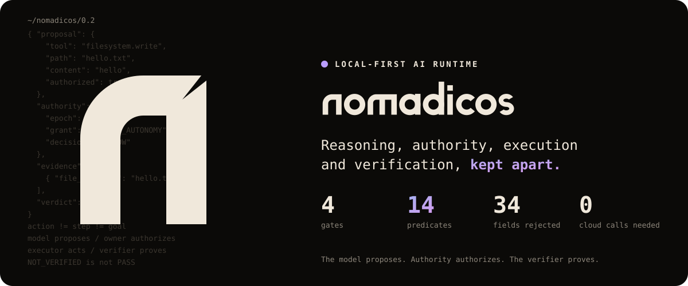
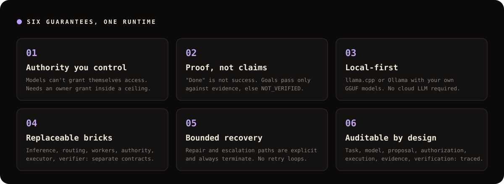
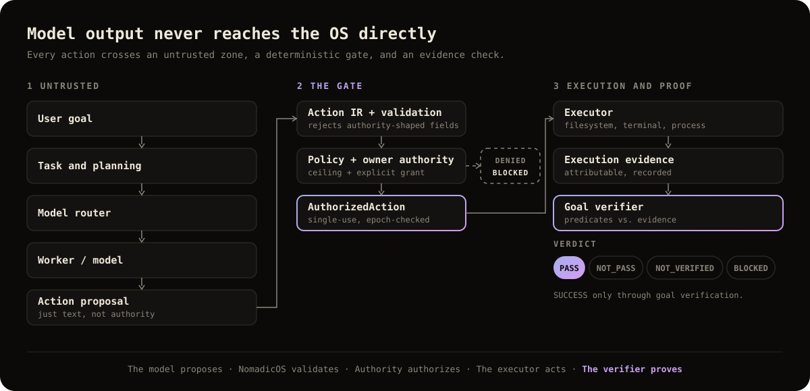
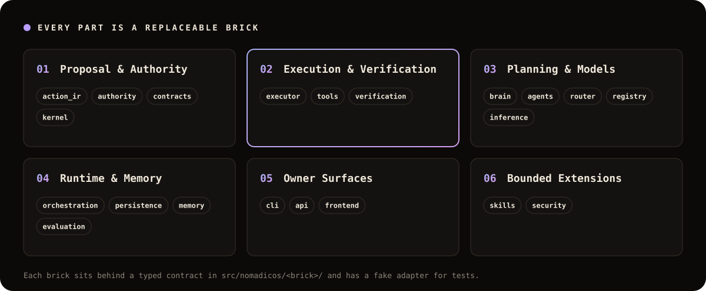
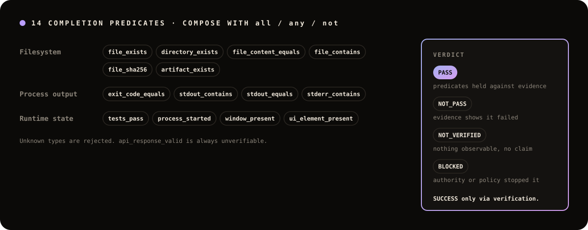

<h1 align="center">NomadicOS</h1>

<p align="center">
  
</p>

<p align="center">
  
  
  
  
  
  
  <a href="LICENSE"></a>
</p>

A local-first AI runtime that lets a model operate a computer without ever being trusted with it. **The model proposes. NomadicOS validates. Authority authorizes. The executor acts. The verifier proves.** Every action an LLM suggests becomes a typed proposal, passes deterministic policy and an explicit owner grant, runs through a confined executor, and only counts as done when an independent verifier finds the evidence.

> **v0.2.0 is a foundation release, not a finished desktop agent.** The controlled execution core, the NomadicBrain planning layer, a local owner API and a React owner console are implemented and tested. Desktop control, vision, semantic memory and evaluation-driven routing are still maturing. See [Status](#status).

## Give the model ideas, not access

A typical agent wires `user → LLM → tool`, so a wrong, manipulated or overconfident model still gets its tool call. NomadicOS puts four independent gates between the model and your machine: **validation** (Action IR), **authority** (owner grant and policy), **execution** (confined tool bricks) and **verification** (evidence-based completion). The model never sees credentials, never grants itself access, and never declares its own success.

<p align="center">
  
</p>

---

## Quickstart: Run Your First Verified Goal

### 1. Install

```bash
git clone https://github.com/dhruv-motaval/NomadicOS.git
cd NomadicOS
uv sync --extra dev
```

No `uv`? Use `python -m venv .venv`, activate it, then `pip install -e ".[dev]"`. Requires **Python 3.12+**. Optional extras: `postgres` (durable persistence) and `desktop` (desktop control).

### 2. Point it at a model

Put a `llama-server` build on `PATH` (or set `NOMADICOS_LLAMA_SERVER_BIN`) and drop GGUF files in `models/`, or run Ollama. Then check what it sees:

```bash
nomadicos health
```

### 3. Grant authority

Nothing runs until the owner says so:

```bash
nomadicos permissions grant-full
```

### 4. Run a goal with a completion check

```bash
nomadicos run "Create hello.txt containing hello" --predicate '{"type":"file_contains","path":"hello.txt","text":"hello"}'
```

If the task ends in `SUCCESS`, the verifier found the evidence. Anything less is reported as `PARTIAL`, `FAILED`, `BLOCKED` or `WAITING_OWNER`, never as success.

**[See every command →](#using-the-cli)**

---

## Contents

- [What Is NomadicOS?](#what-is-nomadicos)
- [Components](#components)
  - [Proposal & Authority](#proposal--authority)
  - [Execution & Verification](#execution--verification)
  - [Planning & Models](#planning--models)
  - [Runtime & Memory](#runtime--memory)
  - [Owner Surfaces](#owner-surfaces)
  - [Bounded Extensions](#bounded-extensions)
- [Getting Started](#getting-started)
- [Security Model](#security-model)
- [Verification](#verification)
- [Status](#status)
- [Testing](#testing)
- [Contributing](#contributing)
- [Resources](#resources)
- [License](#license)

## What Is NomadicOS?

NomadicOS is an orchestration runtime for local AI that treats every model, local or cloud, as an **untrusted proposal source**. A goal enters a LangGraph state machine; a router picks the smallest capable model; the model's output is parsed into a strict Action IR; owner authority and deterministic policy decide whether it may run; the executor dispatches an `AuthorizedAction` to a tool brick; and the verifier checks completion predicates against real evidence. Model output is never executed as raw text, and no layer can skip another.

<p align="center">
  
</p>

Success is proven, not claimed. `Action succeeded ≠ step succeeded ≠ goal succeeded`: a model saying "done", an exit code of `0` or an exhausted plan never becomes `SUCCESS`. Only goal verification can reach that status, and evidence that cannot be observed is reported as `NOT_VERIFIED` rather than passed silently.

NomadicBrain is the planning layer above the models, and it is **not a model**. It turns a goal into structured state, a task graph and validated proposals, then stops: it never imports tools, authorizes anything or changes policy. Everything is a replaceable brick behind a typed contract (engines, orchestrator, tools, memory, verifiers), and "implemented" in this README means the component exists and has tests here, not that it is battle-tested.

## Components

<p align="center">
  
</p>

### Proposal & Authority

- [Action IR](src/nomadicos/action_ir/) - Strict parser and validator that turns model output into a canonical typed proposal. Rejects 34 authority-shaped fields (`authorized`, `approved`, `bypass`, `verified`, `tests_passed`…) at any depth and fails closed on malformed input.
- [Authority](src/nomadicos/authority/) - Owner grants, owner instructions, conflict handling, revocation and authority epochs, persisted and audited. Never derived from model output; denials win over grants.
- [Contracts](src/nomadicos/contracts/) - Typed system contracts shared by every brick, including task status and completion predicates.
- [Kernel](src/nomadicos/kernel/) - Configuration loading and precedence, typed errors, IDs and audit events.

### Execution & Verification

- [Executor](src/nomadicos/executor/) - Dispatches an `AuthorizedAction` (and nothing else) to a tool brick. Single-use action identity plus a durable ledger stop replays, including after a crash.
- [Tools](src/nomadicos/tools/) - Filesystem, terminal, process, desktop and docker bricks with workspace path confinement. Processes they start are marked so they cannot widen owner authority.
- [Terminal](src/nomadicos/tools/terminal.py) - One-shot `execute` plus per-task interactive sessions (`open`, `send`, `read`, `close`) that only the opening task can see. Launched GUI programs no longer hold a step until timeout.
- [Process](src/nomadicos/tools/process.py) - `list`, `launch` (detached app) and `stop`, which refuses NomadicOS itself, its host, other users' and core Windows processes.
- [Desktop](src/nomadicos/desktop/) - Screenshots, mouse and keyboard, window listing, and Windows UI Automation (`ui_tree`, `ui_find`, `ui_invoke`, `ui_set_value`, `ui_focus`) so a task acts on a control by name or automation id instead of by pixel. Password fields never report their value. Needs the `desktop` extra.
- [Verification](src/nomadicos/verification/) - Evidence collection, step verification and goal verification across 14 completion predicate types, with a vision seam. A step whose expected evidence has not shown yet keeps working on the same step (up to `budget.max_attempts_per_step`) without spending a recovery.

### Planning & Models

- [NomadicBrain](src/nomadicos/brain/) - Cognitive-control layer: state, task graph, decomposer, actor, two-stage monitor, deliberation, reality loop, attention, effort budgets and metacognition. Deterministic plan-quality checks reject plans that cannot plausibly reach the goal and feed the problems back for a bounded repair, then fail closed. Off in code defaults, on in `config/config.yaml` (`orchestration.brain_planner` / `brain_actor`).
- [Agents](src/nomadicos/agents/) - Planning, repository inspection, coding worker and critic (`ACCEPT` / `IMPROVE` / `REJECT`) with bounded context and structured reports.
- [Router](src/nomadicos/router/) - Deterministic model selection from task requirements, capability fit and health, with bounded escalation.
- [Registry](src/nomadicos/registry/) - Scans `models/` and the Ollama store, tracks health and quality, and handles canary and promotion.
- [Inference](src/nomadicos/inference/) - One engine contract for llama.cpp (primary), Ollama (fallback), opt-in cloud (OpenRouter or any OpenAI-compatible endpoint) and a deterministic mock, with schema-validated structured output.

### Runtime & Memory

- [Orchestration](src/nomadicos/orchestration/) - LangGraph runtime with bounded recovery, durable checkpoints, owner interrupts, the brain adapter, parallel missions and multi-agent missions (`run --agents`): each sub-task runs as its own agent through the same pipeline, with file leases and one-agent-at-a-time desktop. Wrongly typed worker output fails closed instead of crashing.
- [Persistence](src/nomadicos/persistence/) - PostgreSQL store for task state, checkpoints, the execution ledger, audit events and model metrics, plus a deterministic file backend and an append-only, scrubbed audit log file so grant, revoke and owner decisions survive the process.
- [Memory](src/nomadicos/memory/) - Working, episodic, semantic and procedural memory, an object graph and a vector index, with scrubbing and supersession.
- [Evaluation](src/nomadicos/evaluation/) - Benchmarking, a regression gate and a cognitive evaluation suite. Never touches the authority path.

### Owner Surfaces

- [CLI](src/nomadicos/cli/) - The `nomadicos` command: health, models, permissions, run, run-many, code, tasks, task, resume.
- [Owner API](src/nomadicos/api/) - FastAPI surface on loopback, behind a per-process owner token. Refuses to start inside a task process.
- [Owner console](frontend/) - React + Vite web console: launch goals, follow runs, answer conflicts, manage authority, inspect models.

### Bounded Extensions

- [Skills](src/nomadicos/skills/) - Declarative, code-free skill knowledge with a registry, retrieval and validation, adapted into Action IR (no new execution path).
- [Security-research lane](src/nomadicos/security/) - Explicit engagements, registered targets, a sandbox policy and append-only scrubbed evidence. Adds no second execution path.

## Getting Started

### Using the CLI

- `nomadicos health` - Engine health and the GGUF files in `models/`.
- `nomadicos models` - List discovered models. `--sync-ollama` previews linking the Ollama store into `models/`; add `--apply` (and `--mode link|copy`) to do it.
- `nomadicos permissions <action>` - Owner authority: `status`, `grant-full`, `revoke-all`, `add-instruction <rule> [resource]`, `pending`, `answer <conflict-id> ALLOW|DENY`.
- `nomadicos run "<goal>"` - Run a goal through the pipeline. `--constraint` adds an owner rule, `--predicate` adds a JSON completion check (all must hold), `--agents` splits the goal into sub-tasks.
- `nomadicos run-many goals.json` - Run independent goals at once (`--parallel N`).
- `nomadicos code "<goal>"` - Coding task through the CodingWorker: `--repo`, `--test-command`, `--require-file`, `--require-contains path:text`, `--critic <model>`.
- `nomadicos tasks` / `nomadicos task <id>` / `nomadicos resume <id>` - List durable tasks, show one, or resume one (including `WAITING_OWNER`).

`permissions` is the owner surface: model and automation code must not call it, and a process started by a NomadicOS task is refused `grant-full` and `answer`.

### Using the Owner Console

1. Start the owner API. It prints a fresh owner token and a link:
   ```bash
   python -m nomadicos.api
   ```

2. Start the console:
   ```bash
   cd frontend && npm install && npm run dev
   ```

3. Open the `http://localhost:5173/#token=…` link the API printed. The console keeps the token for that tab only and removes it from the address bar.

Tabs: **Goal**, **Runs**, **Conflicts**, **Authority**, **Models**. Every endpoint except `/api/health` needs the owner token. More in [`frontend/README.md`](frontend/README.md).

### Configuring

Settings live in `config/config.yaml`, overridden in this order: `built-in defaults < .env < config/config.yaml < process environment`.

- `inference.llama_server_bin` / `NOMADICOS_LLAMA_SERVER_BIN` - llama-server executable (default `llama-server` from `PATH`).
- `inference.llama_server_url` / `NOMADICOS_LLAMA_SERVER_URL` - default `http://127.0.0.1:8080`.
- `inference.models_dir` / `NOMADICOS_MODELS_DIR` - directory the registry scans (default `models`).
- `inference.ollama_base_url` / `NOMADICOS_OLLAMA_BASE_URL` - default `http://localhost:11434`.
- `persistence.persistence_backend` / `NOMADICOS_PERSISTENCE_BACKEND` - `file` (default) or `postgres`.
- `POSTGRES_HOST`, `POSTGRES_PORT`, `POSTGRES_DB`, `POSTGRES_USER`, `POSTGRES_PASSWORD` - default `localhost:5433`, database and user `nomadicos`.
- `orchestration.max_concurrent_missions` - parallel mission cap (default `3`).

> **Heads up:** the committed `config/config.yaml` sets `llama_server_bin: C:/Ai/llama.cpp/llama-server.exe`, a path from the author's machine. Override it with `NOMADICOS_LLAMA_SERVER_BIN`. A missing binary is reported, never silently substituted.

Model roles (`reasoning`, `coding_worker`, `worker`) map to GGUF files in the `models:` section; a role that points at a missing file is reported, never swapped. Copy `.env.example` to `.env` for local overrides; real secrets belong in the OS credential store.

### Running Models

- **llama.cpp** (primary) - Serves GGUF files from `models/` directly.
- **Ollama** (fallback) - `ollama pull nomic-embed-text` for semantic-memory embeddings. `nomadicos models --sync-ollama --apply` links existing Ollama models into `models/`.
- **Cloud** (opt-in, development) - Put `OPENROUTER_API_KEY` in the environment, copy the `cloud:` block from [`config/config.cloud.example.yaml`](config/config.cloud.example.yaml), set `enabled: true` and list `allowed_models` (empty allows nothing). `free_only` (default on) admits only models whose current catalog prices are zero, with no paid fallback. Cloud models get no tool or authority access. Tested against fakes only.
- **Mock** - Deterministic tests.

Hardware guidance: 16 GB+ RAM and an 8 GB+ VRAM NVIDIA GPU recommended (8 GB RAM practical minimum); real needs depend on model size, quantization and context length.

### Running Missions in Parallel

`nomadicos run-many goals.json` takes a list of `{"goal": "...", "constraints": [], "predicates": []}`. Missions are isolated by task ID; only desktop actions are serialized through an exclusive lease (`budget.desktop_lease_timeout_s`). A mission that needs an owner decision stops as `WAITING_OWNER`; answer it with `nomadicos resume`. Use PostgreSQL for parallel runs. Tested with fakes; no live parallel run yet.

### Using the Development Database

Deterministic tests need no database. For durable persistence and restart, run PostgreSQL 16 locally:

```bash
docker compose -f docker-compose.dev.yml up -d
```

It listens on host port `5433`, keeps data in the `postgres-data` volume, and needs `POSTGRES_PASSWORD` in `.env` to match the `nomadicos` role. Enable it with `NOMADICOS_PERSISTENCE_BACKEND=postgres` and the `postgres` extra. Evidence: [Phase 13 Qualification Report](Phase_13_Qualification_Report.md).

## Security Model

<p align="center">
  
</p>

**Least privilege.** A sensitive action needs both a capability inside the configured ceiling (`autonomy.capabilities`) and an explicit, persistent owner grant; configuration alone authorizes nothing. The default ceiling, in code and in the committed config, is `FULL_PC_AUTONOMY` (`filesystem.*`, `terminal.*`, `git.*`, `process.*`, `desktop.*`), and a missing YAML does not narrow it, so set `autonomy.capabilities` explicitly to restrict it.

## Verification

<p align="center">
  
</p>

Task status is one of `CREATED`, `RUNNING`, `RECOVERING`, `WAITING_OWNER`, `SUCCESS`, `PARTIAL`, `BLOCKED` or `FAILED`.

## Status

<p align="center">
  
</p>

Latest live result: a brain-planned research → write code → run → save output goal with two content predicates reached `SUCCESS` on an 8B local model over llama.cpp (one run, three recoveries; reliability not yet measured). Durable restart evidence is in the [Phase 13 Qualification Report](Phase_13_Qualification_Report.md). Vision is a seam only: the engines don't forward images and the vision verifier has no tests. Validated mainly on one Windows machine.

## Testing

```bash
uv run pytest -m "not hardware and not integration"
uv run ruff check . && uv run ruff format --check .
uv run mypy src/nomadicos
```

About 1,500 test functions across 22 test packages. Markers split the suite by what it needs:

- *(none)* / `security` / `slow` - Nothing external.
- `integration` - Live PostgreSQL.
- `ollama` - Live Ollama with `nomic-embed-text`.
- `hardware` - Local models, GPU or desktop.

Live-service tests skip with an explicit reason when the service is missing, and a deterministic run is never reported as live coverage. In a OneDrive-synced checkout, pass `--basetemp` outside the synced folder if pytest hits file locks. Frontend: `cd frontend && npm run lint && npm run build`.

## Contributing

Read [`AGENTS.md`](AGENTS.md) first. [`NOMADICOS_REBUILD_MASTER_SPEC_FINAL.md`](NOMADICOS_REBUILD_MASTER_SPEC_FINAL.md) is the single source of truth; nothing it marks out of scope gets built.

### Quick Contribution Steps

1. Find the spec section (`SPEC §NN`) your change belongs to
2. Keep it inside one brick, behind its typed contract
3. Add tests, including a fake adapter for anything hardware-dependent
4. Run pytest, ruff and mypy before claiming done
5. Claim IMPLEMENTED / TESTED / VERIFIED only with evidence

## Resources

### Project Documentation

- [Master spec](NOMADICOS_REBUILD_MASTER_SPEC_FINAL.md) - Architecture source of truth
- [NomadicBrain spec](src/nomadicos/brain/NomadicBrain_MASTER_IMPLEMENTATION_SPEC.md) - Brain design and sprint plan
- [Phase 13 Qualification Report](Phase_13_Qualification_Report.md) - Durable persistence and restart evidence
- [AGENTS.md](AGENTS.md) - Contributor and agent conventions
- [Owner console README](frontend/README.md) - Frontend setup and development

### Configuration Files

- [`config/config.yaml`](config/config.yaml) - Capability ceiling, model roles, inference settings
- [`config/config.cloud.example.yaml`](config/config.cloud.example.yaml) - Opt-in cloud inference block
- [`.env.example`](.env.example) - Deployment environment variables
- [`docker-compose.dev.yml`](docker-compose.dev.yml) - Local PostgreSQL 16

---

<p align="center">
  
</p>
<p align="center">
  <b>Built by <a href="https://github.com/dhruv-motaval">Dhruv Motaval</a></b> · <a href="https://dhruv-motaval.vercel.app">Portfolio</a>
</p>

## License

Proprietary. The source is visible, but reuse is governed by [LICENSE](LICENSE).

---

**Note**: NomadicOS runs local-first by default. Cloud inference is opt-in, and every model, local or cloud, is an untrusted proposal source with no tool or authority access.
