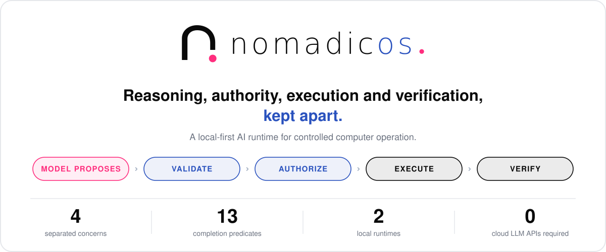
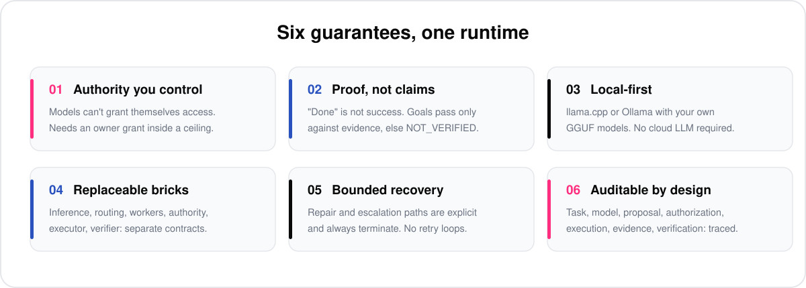
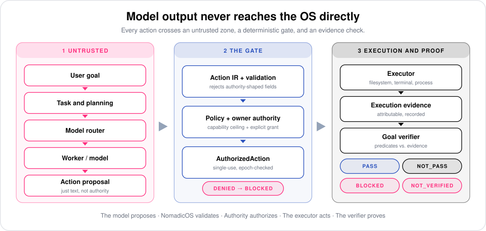
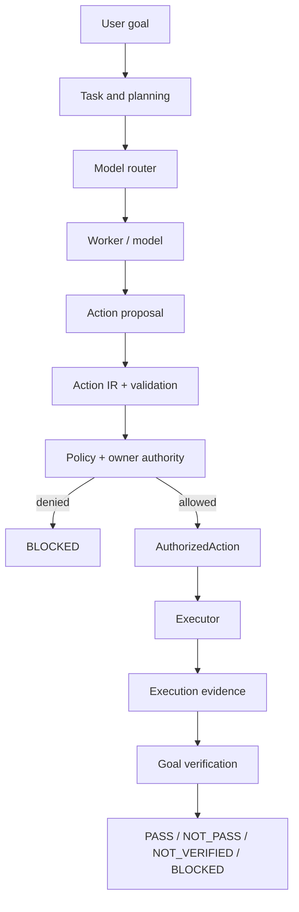
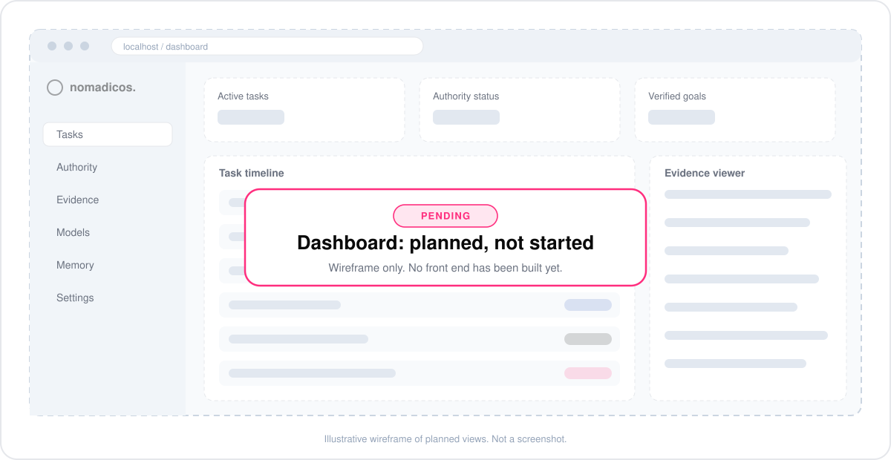

<div align="center">



</div>

#  NomadicOS — The Verifiable Local AI Runtime

> **The model proposes. NomadicOS validates. Authority authorizes. The executor acts. The verifier proves.**

<div align="center">

[](https://github.com/dhruv-motaval/NomadicOS)
[](https://www.python.org/)
[](https://github.com/langchain-ai/langgraph)
[](#-local-inference)
[](#-local-inference)
[](#-status)
[](#-dashboard-pending)
[](LICENSE)

</div>

> [!NOTE]
> **v0.2.0 is a foundation release, not a finished desktop agent, and there is no front end yet.** The controlled execution core (authority, execution, verification, routing, workers, recovery, durable restart) and the NomadicBrain planning layer are implemented and tested. The dashboard is **pending**, and desktop control, vision verification, semantic memory and evaluation-driven routing are still maturing. The [Status](#-status) table is exact about which is which.

## 📍 Where to go

<div align="center">

| | | | |
|---:|:---:|:---:|:---:|
| **🚀 Start** | [🚀 Quick start](#-quick-start) | [🔧 Configuration](#-configuration) | [🧠 Local inference](#-local-inference) |
| **💡 Learn** | [💥 The promise](#-the-promise) | [🤔 Why NomadicOS](#-why-nomadicos) | [🎯 The pipeline](#-the-pipeline) |
| **⚙️ Features** | [🧬 NomadicBrain](#-nomadicbrain) | [🔒 Security model](#-security-model) | [💾 Dev database](#-development-database) |
| **👀 See it** | [📺 Dashboard (pending)](#-dashboard-pending) | [✨ What's new](#-whats-new) | [📊 Status](#-status) |
| **📦 Project** | [🧪 Testing](#-testing) | [🧭 Roadmap](#-roadmap) | [📁 Layout](#-repository-layout) |

</div>

---

## 🚀 Quick start

Requires **Python 3.12+**.

**1. Install**

```bash
git clone https://github.com/dhruv-motaval/NomadicOS.git
cd NomadicOS

# with uv (recommended)
uv sync --extra dev

# or with pip
python -m venv .venv
# activate the venv, then:
pip install -e .
```

Optional extras: `postgres` (durable persistence) and `desktop` (desktop control), for example `uv sync --extra postgres`.

**2. Point it at a local model runtime** (llama.cpp or Ollama, see [Local inference](#-local-inference)), then check it can see one:

```bash
nomadicos health
```

A missing `llama-server` shows up as `EngineUnavailable`, and the configured fallback engine (Ollama by default) is used according to the routing policy.

**3. Decide how much authority to give it.** Every action goes through the owner authority layer:

```bash
nomadicos permissions status        # current grant, epoch and owner instructions
nomadicos permissions grant-full    # explicit, persistent owner grant
nomadicos permissions revoke-all    # revoke everything and bump the authority epoch
```

See [Least privilege by default](#least-privilege-by-default) before you widen anything.

**4. Run a goal**

```bash
nomadicos run "Create hello.txt containing hello"
nomadicos code "Fix the failing test" --repo ./my-repo --test-command "pytest -q"
```

### CLI reference

| Command | What it does |
| --- | --- |
| `nomadicos health` | Engine and model-store health |
| `nomadicos models` | List discovered models. `--sync-ollama` (with `--apply`, `--mode link\|copy`) migrates the Ollama store into `models/` |
| `nomadicos permissions <action>` | Owner authority: `status`, `grant-full`, `revoke-all`, `add-instruction`, `pending`, `answer` |
| `nomadicos run "<goal>"` | Run a goal through the LangGraph pipeline, ending in goal verification (`--constraint` to add constraints) |
| `nomadicos code "<goal>"` | Run a coding task through the CodingWorker (`--repo`, `--test-command`, `--require-file`, `--require-contains`, `--critic`) |
| `nomadicos tasks` | List durable tasks |
| `nomadicos task <task-id>` | Show the persisted summary of a task run |
| `nomadicos resume <task-id>` | Safely resume a durable task through the normal pipeline |

The `permissions` command is the owner surface. Model and automation code must not call it.

---

## 💥 The promise



"Implemented" in this project means the component exists and is covered by tests in this repository. It does not mean battle-tested across many real tasks. See [Status](#-status) for the honest breakdown.

---

## 🤔 Why NomadicOS

A naive agent looks like this:

```text
User  →  LLM  →  Tool
```

That puts the model right next to authority and side effects. If it is wrong, manipulated by text in a repository, or confidently mistaken, the tool call still happens.

NomadicOS pulls four concerns apart:

| | Typical agent | NomadicOS |
| --- | --- | --- |
| **Who decides what's allowed?** | Whatever the prompt or tool wrapper says | Deterministic policy plus an explicit owner grant |
| **What does model output become?** | A tool call | A *proposal* that must pass validation first |
| **Can the model grant itself access?** | Often, by accident | No. 34 authority-shaped fields are rejected at any depth |
| **Who says the task succeeded?** | The model, or an exit code | An independent verifier reading evidence |
| **What about a stale permission replayed later?** | Hope | Epoch checks, single-use action identity and a durable ledger |

---

## 🎯 The pipeline



Model output is never executed as raw text. It becomes a proposal, passes validation and policy, and only then reaches the executor. Success is established afterwards, from evidence.



### The building blocks

| Block | Responsibility | Explicitly *not* |
| --- | --- | --- |
| **Inference** | Replaceable engine boundary: llama.cpp, Ollama, and a deterministic mock for tests | Not tied to one provider |
| **Router** | Deterministic model selection from task requirements, capability fit and health, with escalation | Not authority |
| **Workers** | Planning, repository inspection and coding, with bounded context and structured reports | Not execution authority |
| **Critic** | Reviews work and returns `ACCEPT`, `IMPROVE` or `REJECT` with issues and required tests | Not owner, authority, executor, verifier or router |
| **Action IR** | Strict parser and validator for model proposals | Never executes anything |
| **Authority** | Owner grants, owner instructions, revocation, conflict handling, epochs, audit events | Never derived from model output |
| **Executor** | Dispatches an `AuthorizedAction` to the tool bricks (filesystem, terminal, desktop, docker) | Doesn't pick models, grant permissions or judge success |
| **Verifier** | Evaluates completion predicates against attributable evidence | Doesn't trust "done" |
| **Orchestration** | LangGraph state machine tying it together, with bounded recovery and durable checkpoints | Raw execution stays outside model reasoning |

### Three kinds of "success" are never confused

```text
Action succeeded   ≠   Step succeeded   ≠   Goal succeeded
```

A model saying "done", an exit code of `0`, or an exhausted plan is not proof. A goal passes only when its predicates hold against real evidence. There are **13 completion predicate types**, composable with `all` / `any` / `not`:

| Family | Predicates |
| --- | --- |
| Filesystem | `file_exists` · `directory_exists` · `file_content_equals` · `file_contains` · `file_sha256` · `artifact_exists` |
| Process output | `exit_code_equals` · `stdout_contains` · `stdout_equals` · `stderr_contains` |
| Runtime state | `tests_pass` · `process_started` · `window_present` |

Unknown predicate types are rejected, never treated as satisfied. A predicate whose evidence is missing is reported as unverifiable, never as a silent pass.

### Verdicts and task status

Verification returns four distinct, non-collapsible verdicts:

| Verdict | Meaning |
| --- | --- |
| `PASS` | The predicates held against observed evidence |
| `NOT_PASS` | The evidence shows the goal state was not reached |
| `NOT_VERIFIED` | There was nothing testable, or the evidence could not be observed, so no result is claimed |
| `BLOCKED` | Authority or policy stopped the action |

A task's overall status is one of `CREATED`, `RUNNING`, `RECOVERING`, `WAITING_OWNER`, `SUCCESS`, `PARTIAL`, `BLOCKED` or `FAILED`. **`SUCCESS` is only reachable through goal verification.**

---

## 🧬 NomadicBrain

NomadicBrain is the cognitive-control layer that sits above models and capabilities. It is **not a model**, **not a tool executor**, and **not a replacement for the NomadicOS security and runtime boundaries**. It turns a goal into structured state, a task graph and validated action proposals, and then stops. Everything it proposes still goes through Action IR, owner authority, the executor and goal verification.

```text
Goal → BrainState → TaskGraph → Decomposer → Actor → Monitor → bounded refinement → PlanningOutcome
```

The design rules, taken from the spec:

- **Brain ≠ model.** Models are replaceable reasoning engines behind a `StructuredGenerator` protocol. No model-specific logic lives in the brain.
- **Cognition ≠ execution.** The brain never imports concrete tools, authorizes anything or mutates policy. Its output is data.
- **Evaluation ≠ verification.** An evaluator estimates how good a predicted state looks. Only the verifier checks reality.
- **Hard controls are deterministic.** Authorization, scope, permissions and resource limits never rely on model output.

It was built in ten sprints. All ten have code in `src/nomadicos/brain/` and the packages beside it:

| Sprint | Layer | Main modules | Dedicated tests |
| :---: | --- | --- | :---: |
| 1 | Foundation: state, schemas, events, task graph, deterministic orchestrator | `state`, `schemas`, `events`, `planner/` | ✅ |
| 2 | MAP core: decomposer, actor, two-stage monitor, bounded actor/monitor loop | `decomposer`, `actor`, `monitor`, `loop` | ✅ |
| 3 | Deliberation: predictor, evaluator, bounded search, selector | `deliberation` | 🟡 search covered, coordinator and model predictor/evaluator not directly |
| 4 | Reality loop: connects deliberation to real execution | `reality`, `reality_loop` | ✅ |
| 5 | Memory seam and uncertainty tracking | `memory`, `uncertainty` | ✅ |
| 6 | Adaptive intelligence: attention, effort budgets, metacognition | `attention`, `effort`, `metacognition`, `adaptive` | ✅ |
| 7 | Model independence | `models`, `cognition` | ✅ |
| 8 | Skills: declarative, code-free skill knowledge behind a narrow seam | `brain/skills`, `skills/` | ✅ |
| 9 | Bounded security-research lane | `brain/security`, `security/` | ✅ |
| 10 | Soak harness and trace reconstruction | `soak`, `trace` | 🟡 soak covered, trace not directly |

| 10 | Soak harness and trace reconstruction | `soak`, `trace` | 🟡 soak covered, trace not directly |

It is wired into the LangGraph pipeline through `orchestration/brain_adapter.py`, `brain_planner.py`, `graph.py` and `adaptive_decision.py`. The full design is in [`NomadicBrain_MASTER_IMPLEMENTATION_SPEC.md`](src/nomadicos/brain/NomadicBrain_MASTER_IMPLEMENTATION_SPEC.md). Brain-led planning is **opt-in** (`brain_actor` / `brain_planner` flags) — the default CLI run path uses the deterministic planner, with the same Actor → proposal → authority → executor → verifier flow underneath.

---

## 🔒 Security model

NomadicOS treats model output and all external text as **untrusted data**.

| Threat | What happens |
| --- | --- |
| Model claims it is authorized | Ignored. Only the authority subsystem can create an `AuthorizedAction`. |
| Prompt injection in repo files, tool output or test output | Treated as data. It cannot change authority. |
| Authority-shaped fields in a proposal | **34** field names (for example `authorized`, `approved`, `owner_approved`, `capability`, `permission`, `bypass`, `security_override`, `verified`, `goal_complete`, `tests_passed`) are rejected at the top level, nested in args, or at any depth. |
| Path escape | Filesystem and terminal operations use workspace path confinement instead of trusting raw model paths. |
| Stale authorization after a policy change | Authorization carries an epoch. Revocation invalidates it at the execution boundary. |
| Duplicate side effects, including after a crash | Action identity and a durable execution ledger stop the same authorized action running twice. An outcome the ledger cannot confirm is treated as unknown, and retry stops instead of replaying. |
| Unearned success | Executor success, "plan finished" and "no error recorded" never become goal `SUCCESS` on their own. |

### Least privilege by default

A sensitive action needs **both**:

1. The capability is inside the **configured ceiling** (`autonomy.capabilities` in `config/config.yaml`).
2. The owner has made an **explicit, persistent grant** (`nomadicos permissions grant-full`). Configuration alone never authorizes anything.

To deliberately widen autonomy (terminal, git, process, desktop), include those capability patterns in your config **and** run the grant. Owner instructions (`permissions add-instruction`) and conflict answers (`permissions pending` / `answer`) let the owner deny specific resources, and denials take precedence.

The Python defaults match this posture: a fresh `AppConfig()` uses a `LIMITED` profile with a filesystem-only capability ceiling, and loading with a missing or unavailable YAML cannot silently restore a broader ceiling.

### Bounded security-research lane

A separate, strictly scoped capability for security research: explicit engagements, explicitly registered targets, explicit capability grants, a sandbox policy, append-only scrubbed evidence and a full audit trail. It adds **no second execution path**. The existing Action IR, validator, authorization and executor remain the only execution authority.

---

## 🔧 Configuration

Settings live in `config/config.yaml`, with environment overrides. Precedence, later wins:

```text
built-in defaults  <  .env  <  config/config.yaml  <  process environment
```

| Setting | YAML key | Environment variable | Default |
| --- | --- | --- | --- |
| llama-server executable | `inference.llama_server_bin` | `NOMADICOS_LLAMA_SERVER_BIN` | `llama-server` (from `PATH`) |
| llama-server URL | `inference.llama_server_url` | `NOMADICOS_LLAMA_SERVER_URL` | `http://127.0.0.1:8080` |
| llama-server port | `inference.llama_port` | `NOMADICOS_LLAMA_PORT` | `8080` |
| Models directory | `inference.models_dir` | `NOMADICOS_MODELS_DIR` | `models` |
| Ollama endpoint | `inference.ollama_base_url` | `NOMADICOS_OLLAMA_BASE_URL` | `http://localhost:11434` |
| Persistence backend | `persistence.persistence_backend` | `NOMADICOS_PERSISTENCE_BACKEND` | `file` (`postgres` is opt-in) |
| PostgreSQL connection | `persistence.postgres_*` | `POSTGRES_HOST`, `POSTGRES_PORT`, `POSTGRES_DB`, `POSTGRES_USER`, `POSTGRES_PASSWORD` | `localhost:5433`, database and user `nomadicos` |

The committed config contains no machine-specific paths. An explicit, existing `llama_server_bin` is always honored, and a bare name resolves through `PATH`. A missing binary reports `EngineUnavailable`. NomadicOS never silently substitutes a different executable or model.

Model roles (`reasoning`, `coding_worker`, `worker`) map to GGUF files in the `models:` section. **Path-resolution rule:** a role value is resolved against the process working directory (the repository root in normal CLI use); absolute paths are honored as-is and are never joined onto `models_dir` — `inference.models_dir` is the discovery directory the registry scans (and the fallback when no role is configured), and relocating it with `NOMADICOS_MODELS_DIR` relocates the actual lookup for the role's file name. A configured role that resolves to a missing file is reported honestly, never substituted.

Create a `.env` for local overrides (never committed; `.env.example` documents the deployment variables). Real secrets belong in the OS credential store, not in `.env`.

---

## 🧠 Local inference

NomadicOS supports two runtimes behind one interface:

- **llama.cpp** for GGUF models (primary). Install a `llama-server` build and put it on `PATH`, or set `NOMADICOS_LLAMA_SERVER_BIN`.
- **Ollama** (compatibility and fallback). Pull what you need, for example `ollama pull nomic-embed-text` for semantic memory embeddings.

A model registry scans your `models/` directory and the Ollama store, tracks health and quality metrics, and the router picks a model per role.

### Recommended model roles

These are target assignments. They are configuration, not hard-coded dependencies.

| Role | Model | Used for |
| --- | --- | --- |
| Primary worker | `Ornith 1.5 9B` | General reasoning, planning, coding, tool use |
| Deep reasoning / critic | `gpt-oss:20b` | Harder reasoning, debugging, stronger evaluation |
| Coding escalation *(optional)* | `qwen3-coder:30b-a3b-q4_K_M` | Larger coding specialist, needs more memory |
| Vision *(future)* | `gemma3:4b` | Screenshot understanding |

> [!IMPORTANT]
> **Vision is not working end to end yet.** The message contract has an optional `images` field and a `VisionGoalVerifier` exists in `verification/vision.py`, but the llama.cpp and Ollama adapters do not forward images today, and the vision verifier has no tests. Treat vision as a seam, not a capability. Live hardware tests use `qwen3:14b`, which is historical evidence, not the recommended assignment.

<details>
<summary><b>Hardware guidance</b></summary>

<br>

| | Recommended | Minimum practical |
| --- | --- | --- |
| OS | Windows 11 or modern Linux | same |
| CPU | 6+ cores | 4+ cores |
| RAM | 16 GB+ | 8 GB+ |
| GPU | NVIDIA, 8 GB+ VRAM | optional, 4 to 6 GB+ VRAM helps |
| Storage | 50 GB+ SSD | 20 GB+ |

Real requirements depend on model size, quantization, context length and GPU offloading.

</details>

---

## 💾 Development database

Deterministic tests need no database. Durable persistence uses a local PostgreSQL 16:

```bash
docker compose -f docker-compose.dev.yml up -d
docker compose -f docker-compose.dev.yml ps    # wait for (healthy)
```

What it stores: durable task state, LangGraph checkpoints, the execution ledger, audit events and model metrics. This is what makes `nomadicos tasks` and `nomadicos resume <task-id>` work across restarts. The [Phase 13 Qualification Report](Phase_13_Qualification_Report.md) records the verdict and the real-PostgreSQL evidence behind it.

- **Port 5433.** The dev database maps host port `5433` to `5432` inside the container, because `5432` is often taken by a local PostgreSQL.
- **Data persists** in the named volume `postgres-data` across container recreation.
- **Credentials.** The compose file documents a dev-only password for the local container; `POSTGRES_PASSWORD` in `.env` is what the runtime connects with and must match the `nomadicos` role's actual password in the database.
- **Safe tests.** Integration tests read `NOMADICOS_TEST_DSN` (default port 5433) and use isolated identifiers.
- **Opt-in.** The default backend is the deterministic file adapter. Set `NOMADICOS_PERSISTENCE_BACKEND=postgres` (and install the `postgres` extra) to use PostgreSQL.

---

## 📺 Dashboard (pending)



**There is no front end yet.** Today NomadicOS is driven from the CLI. The wireframe above is an illustrative sketch of planned views, not a screenshot.

| Planned view | What it would show | Status |
| --- | --- | :---: |
| **Tasks** | Live task timeline: goal, steps, selected model, outcome | ⏳ Pending |
| **Authority** | Current grant, capability ceiling, epoch, revocation | ⏳ Pending |
| **Evidence** | Execution evidence and which predicate each piece satisfied | ⏳ Pending |
| **Models** | Registry, health, routing decisions and escalations | ⏳ Pending |
| **Memory** | Episodic, semantic and procedural memory browser | ⏳ Pending |

The CLI and the typed contracts underneath stay the source of truth. A dashboard will read from them and will not get its own path around authority.

---

## 📊 Status

| Area | v0.2.0 |
| --- | :---: |
| Kernel contracts and typed state | ✅ Implemented |
| Local inference abstraction (llama.cpp, Ollama, mock) | ✅ Implemented |
| Model registry, scanner and deterministic routing | ✅ Implemented |
| Action IR parsing and validation | ✅ Implemented |
| Owner authority, instructions and conflict handling | ✅ Implemented |
| Tool bricks: filesystem, terminal | ✅ Implemented |
| Tool brick: docker | 🟡 Wired in, no dedicated tests yet |
| Process supervision and cleanup | ✅ Implemented |
| LangGraph orchestration | ✅ Implemented |
| Goal verification (13 predicate types) | ✅ Implemented |
| Coding worker and critic / evaluator | ✅ Implemented |
| Bounded recovery and repair flow | ✅ Implemented |
| Durable persistence and restart / resume (PostgreSQL) | ✅ Implemented, qualified against PostgreSQL 16 in Phase 13 |
| NomadicBrain: planning, MAP loop, adaptive intelligence | ✅ Implemented |
| NomadicBrain: deliberation (predictor, evaluator, search) | 🟡 Implemented, partly tested |
| Skills system | ✅ Implemented |
| Bounded security-research lane | ✅ Implemented |
| Desktop control (Windows backend) | 🟡 Foundation |
| Semantic memory and object graph | 🟡 Foundation |
| Vision goal verification | 🟡 Seam only, not wired to engines |
| Evaluation-driven routing improvement | 🟡 In progress |
| **Dashboard / front end** | ⏳ **Pending** |

### Known limitations

- **No front end.** CLI only, for now.
- **Not a general desktop agent yet.** Desktop and application control is a foundation only, with a Windows backend.
- **Vision is not functional end to end.** See the note under [Local inference](#-local-inference).
- **Docker tool has no dedicated tests yet.**
- **Deliberation is partly tested.** The bounded search is covered, but the deliberation coordinator and the model predictor and evaluator have no direct tests yet, and trace reconstruction has none either.
- **Validated mainly on one Windows machine.** Cross-platform behavior is designed in (for example `PATH` discovery of `llama-server`) but isn't yet backed by CI on Linux.
- **Live tests need local setup.** `integration`, `ollama` and `hardware` suites need PostgreSQL, Ollama with `nomic-embed-text`, or local models.
- **Proprietary license.** The source is visible, but reuse is governed by [LICENSE](LICENSE).

---

## 🧪 Testing

```bash
uv run pytest -m "not hardware and not integration"   # deterministic suite
uv run ruff check .
uv run ruff format --check .
uv run mypy src/nomadicos
```

The suite has well over a thousand test functions across 20 test packages, mirroring most source packages plus `hardware/`. Tests are split by what they need, and a run never claims coverage it didn't have:

| Marker | Requires | Proves |
| --- | --- | --- |
| *(none)* | nothing external | scheduler, authority, Action IR, brain, memory with mocked embeddings, file-backed persistence |
| `security` | nothing external | authority and completion-integrity invariants |
| `integration` | live PostgreSQL | durable task state, execution ledger, checkpoints, restart recovery |
| `ollama` | live Ollama + `nomic-embed-text` | real embedding dimensions, paraphrase retrieval, index persistence, lexical fallback |
| `hardware` | local models, GPU or desktop | live model and desktop behavior |
| `slow` | nothing external | long-running tests |

`integration`, `ollama` and `hardware` tests skip with an explicit reason when their service is unavailable. A deterministic run is never reported as live-service coverage.

<details>
<summary><b>Test environment notes</b></summary>

<br>

- `pythonpath = ["src", "tests"]` is set in `pyproject.toml`, so no editable install is needed to run the suite.
- Keep pytest scratch files out of cloud-synced folders. Temp directories inside a OneDrive-synced checkout can hit file-sync locks (`PermissionError` on atomic replace or cleanup).

</details>

---

## ✨ What's new

- **v0.2.0 (published release):** the controlled execution core: authority, Action IR, executor, goal verification, routing, workers, critic, bounded recovery, PostgreSQL durable restart, NomadicBrain, skills and the security-research lane.
- **Post-release hardening ([PR #2](https://github.com/dhruv-motaval/NomadicOS/pull/2), in review, not merged):**
  - Portable model configuration with `NOMADICOS_*` environment overrides and no machine-specific paths.
  - A least-privilege example config, with broad autonomy still requiring the explicit owner grant.
  - Loopback-only development database binding.
  - pytest scratch files moved out of the repository tree.
  - A fix for `VectorIndex` persistence, where metadata was written to disk but not mirrored in memory.

Items under PR #2 become part of the release only after the PR is merged.

---

## 🧭 Roadmap

Extending the controlled execution core without weakening its authority and verification boundaries:

- [ ] **Dashboard / front end** (tasks, authority, evidence, models, memory)
- [ ] Vision verification wired through the engine adapters and tested
- [ ] Direct tests for brain deliberation and trace reconstruction
- [ ] Desktop and application control, matured beyond foundation
- [ ] Semantic memory and object graph, matured beyond foundation
- [ ] Evaluation-driven routing optimization
- [ ] CI on Linux and Windows

---

## 📁 Repository layout

<details>
<summary><b>Show the source tree</b></summary>

<br>

```text
NomadicOS/
├── src/nomadicos/
│   ├── action_ir/       # proposal parsing and validation
│   ├── agents/          # planning, coding, repository inspection, critic
│   ├── authority/       # owner authority, policy, conflicts, persistent store
│   ├── brain/           # NomadicBrain: state, task graph, MAP loop, deliberation, adaptive layer
│   ├── cli/             # Typer command-line interface
│   ├── contracts/       # typed system contracts
│   ├── desktop/         # desktop control foundation (Windows backend)
│   ├── evaluation/      # benchmarking, regression gate, cognitive evaluation suite
│   ├── executor/        # AuthorizedAction dispatch
│   ├── inference/       # llama.cpp / Ollama / mock engines, structured output
│   ├── kernel/          # events, errors, IDs, configuration
│   ├── memory/          # working, episodic, semantic, procedural memory, graph, vector index
│   ├── orchestration/   # LangGraph runtime, checkpointing, brain adapter, outcomes
│   ├── persistence/     # PostgreSQL store, checkpoints, execution ledger, metrics
│   ├── registry/        # model registry, scanner, Ollama store, canary, promotion
│   ├── router/          # task analysis, model selection, escalation, quality
│   ├── security/        # bounded security-research lane
│   ├── skills/          # declarative skills: registry, retrieval, validation, Action IR adapter
│   ├── tools/           # filesystem, terminal, desktop and docker tool bricks
│   └── verification/    # evidence, predicates, step and goal verification, vision seam
├── assets/              # logo and README diagrams
├── tests/               # mirrors most source packages, plus hardware/
├── config/config.yaml   # capability ceiling, model roles, inference settings
├── docker-compose.dev.yml
├── NOMADICOS_REBUILD_MASTER_SPEC_FINAL.md
├── Phase_13_Qualification_Report.md
├── AGENTS.md
└── pyproject.toml
```

</details>

---

## 📚 Documentation

| Document | What it covers |
| --- | --- |
| [`NOMADICOS_REBUILD_MASTER_SPEC_FINAL.md`](NOMADICOS_REBUILD_MASTER_SPEC_FINAL.md) | Architecture source of truth |
| [`NomadicBrain_MASTER_IMPLEMENTATION_SPEC.md`](src/nomadicos/brain/NomadicBrain_MASTER_IMPLEMENTATION_SPEC.md) | NomadicBrain design and sprint plan |
| [`Phase_13_Qualification_Report.md`](Phase_13_Qualification_Report.md) | Durable persistence and restart qualification, with real PostgreSQL evidence |
| [`AGENTS.md`](AGENTS.md) | Contributor and agent conventions |
| [`config/config.yaml`](config/config.yaml) | Capability ceiling, model roles, inference settings |

---

<div align="center">


**Built by [Dhruv Motaval](https://github.com/dhruv-motaval)** · [Portfolio](https://dhruv-motaval.vercel.app)

<sub>Distributed under the license in [LICENSE](LICENSE).</sub>

</div>
