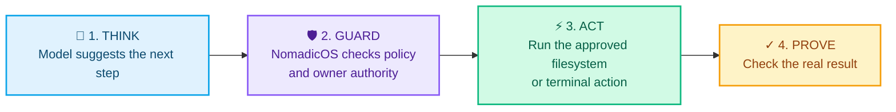
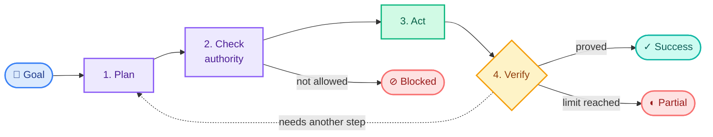

<p align="center">
  <h1 align="center">NomadicOS</h1>
  <p align="center"><strong>Local-first AI orchestration for controlled computer operation.</strong></p>
  <p align="center"><em>Models propose. NomadicOS authorizes. Executors act. Verifiers prove.</em></p>
  <p align="center"><a href="#the-idea">Architecture</a> · <a href="#cli-quickstart">Quickstart</a> · <a href="#security-and-authority-model">Security model</a> · <a href="NOMADICOS_REBUILD_MASTER_SPEC_FINAL.md">Specification</a></p>
</p>

<p align="center">
  
  
  
  
  
</p>

---

NomadicOS is a Python runtime for AI systems that operate a local environment without treating generated text as permission. Reasoning, authority, side effects, and proof of completion each have their own explicit, testable boundary.

> [!IMPORTANT]
> **v0.2.0 is a controlled-execution foundation—not a finished general-purpose desktop agent.** Desktop control, durable restart behavior, semantic memory, and broader tool coverage are still in development.

| Build with confidence | Run locally | Verify honestly |
| --- | --- | --- |
| Typed actions, owner authority, and policy | llama.cpp primary · Ollama compatible | Evidence, completion predicates, and explicit outcomes |

## The idea

A conventional agent often connects a model straight to tools:

```text
User → LLM → Tool
```

NomadicOS makes one critical distinction simple: **a model can suggest work, but it cannot approve itself or declare victory.**



If the proof is missing, NomadicOS says so. It can continue, recover, stop as blocked, or report `NOT_VERIFIED`—but it does not turn a model’s “done” into a result.

## What is implemented

| Area | Current implementation |
| --- | --- |
| Typed contracts and kernel events | Yes |
| Local inference | llama.cpp primary; Ollama compatibility backend; mock engine for tests |
| Model registry and routing | Yes — deterministic task analysis and capability-based selection |
| Action pipeline | Strict parsing, validation, capability resolution, policy, and authorization |
| Owner authority | Persistent `FULL_PC_AUTONOMY`, revocation, authority epochs, and conflict handling |
| Execution | Authorized filesystem operations and structured terminal commands with process supervision |
| Orchestration | LangGraph task flow with bounded recovery and escalation paths |
| Verification | Evidence-backed step and goal verification |
| Agent roles | Planning, repository inspection, coding worker, and critic/evaluator |
| Persistence integrations | PostgreSQL integration hooks |
| Desktop / semantic memory | Foundation only; not a verified end-to-end capability |

## Security and authority model

NomadicOS is designed so authority is never inferred from model output, tool output, repository text, or memory.

```text
Model output      ≠ authority
Repository text   ≠ authority
Tool output       ≠ authority
Critic feedback   ≠ authority
```

The owner remains the highest authority. A one-time `FULL_PC_AUTONOMY` grant can allow ordinary actions without repeated prompts; an explicit owner-instruction conflict is surfaced for an `ALLOW` or `DENY` decision. Revocation advances the authority epoch, allowing stale authorizations to be rejected at the execution boundary.

The Action IR rejects authority-shaped fields supplied by a model, including `authorized`, `approved`, `permission`, `capability`, and `bypass`. Execution consumes an `AuthorizedAction`, not raw model text.

## Architecture

Rather than a monolith, the codebase is organized around a few clear responsibilities:

| 🧭 Coordinate | 🧠 Decide | 🛡️ Control | ✓ Prove |
| --- | --- | --- | --- |
| **`kernel/`** — configuration, events, errors<br>**`contracts/`** — shared typed contracts<br>**`cli/`** — command-line entry point | **`inference/`** — llama.cpp, Ollama, test engine<br>**`registry/`** — local model discovery<br>**`router/`** — task analysis and model selection<br>**`agents/`** — planning, coding, inspection, critic | **`action_ir/`** — proposal parsing and validation<br>**`authority/`** — owner state, policy, authorization<br>**`executor/`** — authorized-action dispatch<br>**`tools/`** — filesystem, terminal, processes | **`orchestration/`** — LangGraph task flow<br>**`verification/`** — evidence and completion checks<br>**`evaluation/`** — benchmarks and evaluation |

The high-level lifecycle is:



Security authority and raw OS execution stay outside model reasoning. The executor does not choose models, grant permissions, change policy, or determine whether the overall goal succeeded.

## Local inference

NomadicOS does not require a cloud LLM API for its initial core.

- **llama.cpp** is the primary local inference path. It communicates with a local `llama-server` through its OpenAI-compatible HTTP interface.
- **Ollama** is supported as a compatible local backend.
- **MockEngine** supports deterministic tests without a live model.

The inference layer is deliberately replaceable. Model selection is separated from execution and uses task requirements, capability fit, health, and configured routing rather than binding the runtime to one provider.

## Install

NomadicOS requires Python 3.12 or later.

```bash
git clone https://github.com/dhruv-motaval/NomadicOS.git
cd NomadicOS

# Preferred
uv sync

# Or install from a virtual environment
python -m venv .venv
# activate the environment for your shell
pip install -e .
```

Install development dependencies:

```bash
uv sync --extra dev
```

## CLI quickstart

The package exposes a `nomadicos` command. Start by checking what is available locally, then make an explicit owner grant only when you are ready to allow actions.

```bash
# Inspect the configured local engines and discovered models
nomadicos health
nomadicos models

# Inspect or administer owner authority
nomadicos permissions status
nomadicos permissions grant-full
nomadicos permissions revoke-all

# Run a goal through the orchestrated task graph
nomadicos run "Create a file containing a specific string"

# Run a coding task with explicit completion predicates
nomadicos code "Fix the parser regression" \
  --repo . \
  --test-command "python -m pytest -q" \
  --require-file "tests/test_parser.py"
```

Use `nomadicos --help` or a command’s `--help` output for the full interface. Local inference services and model files must be configured separately; `nomadicos health` reports their availability honestly.

## Testing and quality checks

The test suite separates normal deterministic coverage from hardware- or live-model-dependent validation.

```bash
uv run pytest
uv run ruff check .
uv run ruff format --check .
uv run mypy src
```

Tests marked `hardware` require local models and, where applicable, local GPU or desktop resources. The repository also includes security-oriented tests for authority, Action IR validation, prompt-injection resistance, duplicate execution prevention, and completion integrity.

## Completion evidence

Goal verification is separate from execution success. Supported evidence-backed predicates include:

```text
file_exists
directory_exists
file_content_equals
file_contains
file_sha256
artifact_exists
exit_code_equals
stdout_contains
stdout_equals
stderr_contains
```

If a goal has no testable completion predicate, NomadicOS does not manufacture a success result.

## Project status and direction

v0.2.0 establishes the core control plane for model-mediated local execution. Current development is oriented around extending that core without weakening its authority and verification boundaries:

- desktop and application control;
- semantic memory and object-graph capabilities;
- long-lived persistence and restart recovery;
- a broader worker/tool ecosystem;
- evaluation-driven routing improvements.

For the detailed architecture and requirements, see [NOMADICOS_REBUILD_MASTER_SPEC_FINAL.md](NOMADICOS_REBUILD_MASTER_SPEC_FINAL.md).

## License

This repository is distributed under the terms in [LICENSE](LICENSE).
